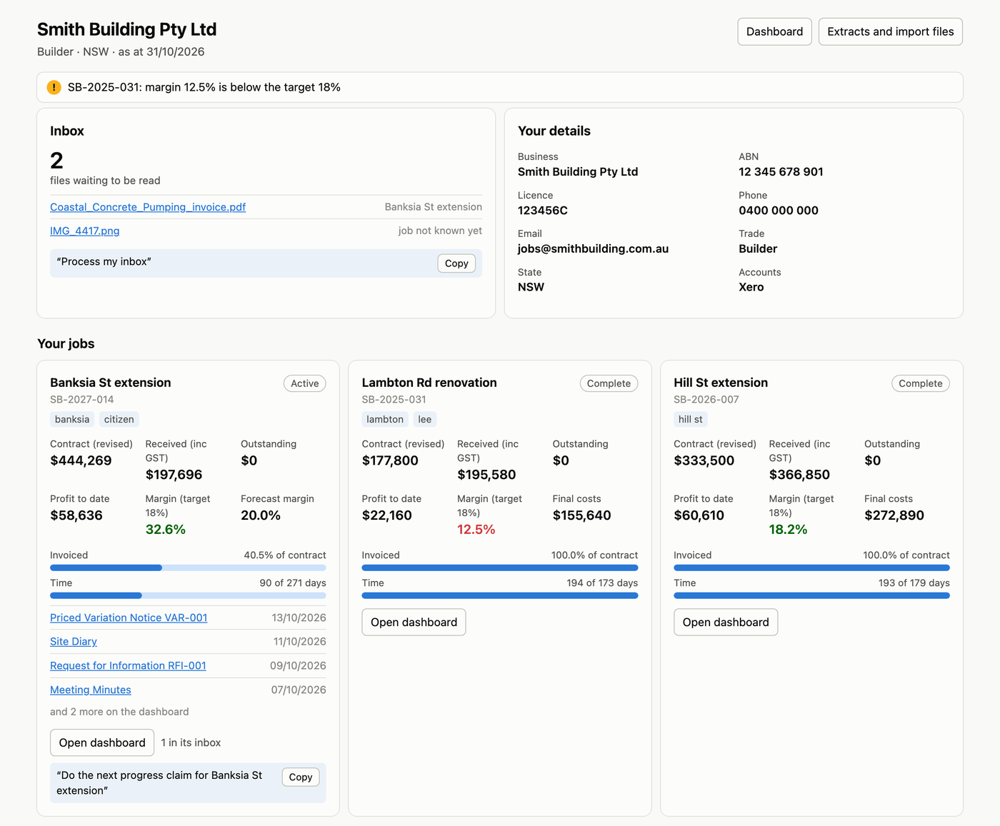
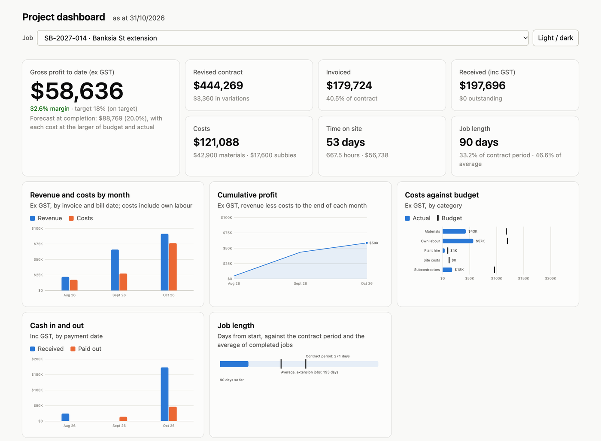
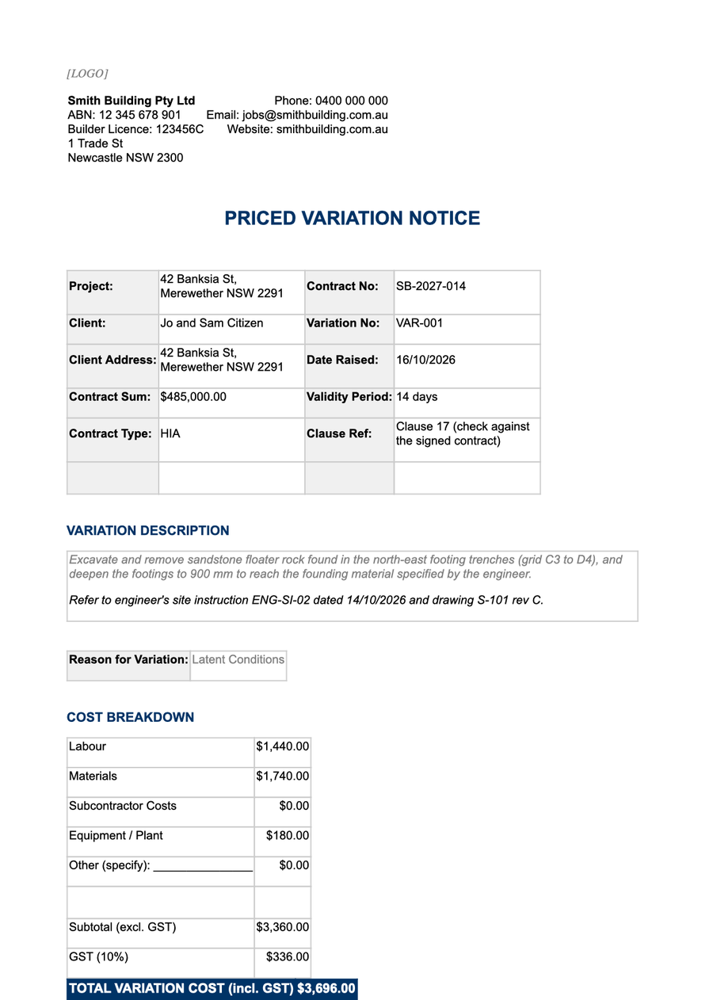

# Australian Builder's Brain

**Your paperwork, sorted.** A free set of Claude skills for Australian builders and tradies. Tell it what happened on site and it writes the quote, variation, claim, notice or SWMS. Drop in a supplier invoice and it reads it, checks it and files it against the job. It knows the National Construction Code for your state.

## What it does

- **Jobs and paperwork.** A folder for each job. Drop in invoices, receipts, dockets and photos, and it reads them, checks the numbers and files them.
- **Documents in a sentence.** 64 ready-made templates: quotes, variations, progress claims, payment claims and schedules, delay and breach notices, SWMS, site diary, handover and more.
- **Money.** Job profit and margin, cash in and out, costs against budget, and import files for Xero, MYOB or QuickBooks. BAS and TPAR figures too.
- **The building code, in plain English.** Ask "how high does my deck balustrade need to be?" and get a straight answer with the clause, for NCC 2025 and 2022, filtered to your trade and state. Plain-English guides cover decks and stairs, wet areas, termites, bushfire, energy, smoke alarms, ceiling heights and footings, and every figure in them is checked against the code text itself.
- **Know your materials.** Guides written for the trade: which treated pine goes where (H3, H4 or H5), screws that won't rust out near the coast, which plasterboard for which room, ordering concrete, membranes, insulation, wall wraps and paint.
- **Materials lists and prices.** Tell it the job (deck, fence, slab, wall, cladding, retaining wall, pergola, roof, insulation and more) and it works out what to buy. It prices the list from your own price list or Bunnings product pages, reads pack sizes off the product, and buys the cheapest mix of tins or boxes.
- **Licences, ABNs and insurance checked.** It checks your ABN and licence on the public registers when you set up, and a subbie's or supplier's when they start or their first invoice comes in. It warns you a month before your insurance runs out.
- **Gets smarter as you use it.** It learns which products you actually use and spots when you switch, and you can choose to share an anonymous summary (no prices, jobs or clients) to help improve it for everyone.
- **Made for your trade.** Builders see everything; a sparky, plumber or tiler sees what matters to them.

## Get started (5 minutes, no terminal)

You need a Claude Pro or Max plan and the [Claude desktop app](https://claude.ai/download).

1. In your web browser, go to [claude.ai → Customize → Plugins](https://claude.ai/customize/plugins), then **Add → Add marketplace**.
2. Enter `grechj/Australian-Builders-Brain` and press **Sync**. On the **Discover** tab, find **Australian Builder's Brain** and click **Add**. Turn on **Sync automatically** to get updates.
3. In the desktop app, open **Cowork**, then **Projects → +**. Choose **Start from scratch** and call it `Jobs` (or **Use an existing folder**, for example one in Dropbox, Google Drive or OneDrive so you can add photos from your phone).
4. Click the project to start a session. The brain says hello and offers to set you up.
5. Say **"set me up"**. It asks your trade, state and business details, walks you through a practice job and shows you what to ask.

If adding the marketplace fails in the desktop app, do step 1 and 2 on claude.ai in a browser; the plugin then appears in the desktop app too. No luck either way? Download **australian-builders-brain.zip** from the [latest release](https://github.com/grechj/Australian-Builders-Brain/releases/latest) and use **Add → Upload plugin** instead (re-upload a new zip to update).

Using Claude Code in a terminal? `claude plugin install australian-builders-brain --marketplace grechj/Australian-Builders-Brain`

## What it looks like

A dashboard for every job: profit, margin, cash, costs against budget, time on site, and every document.

Things to try once you're set up:

- *"What's the balustrade height on a deck 1.5 m off the ground in the ACT?"*
- *"Which treated pine do I need for retaining wall posts?"*
- *"Materials for a 6 m sleeper retaining wall, 800 mm high"*
- *"Check this subbie's licence and ABN"*
- *"What products have I been using most?"*

Documents come out filled in from one sentence, with the money worked out and checked:

## Good to know

- **Your files stay yours.** Everything lives in your own folder. No accounts, no keys, nothing stored by this project.
- **Money is checked, not guessed.** GST, claims, variations, BAS and TPAR come from tested calculations, with a receipt you can verify.
- **Code answers are pinned to the code.** Every figure in a plain-English guide is checked against the NCC sentence it came from, every time the brain is updated, and every link lands on the clause it names.
- **Your prices stay private.** The brain records what products are sold as (sizes and pack sizes), never what anyone paid. Your price list and materials log live in your folder, and nothing is shared unless you post it yourself.
- **You approve everything.** Nothing goes into your books or out the door until you say yes.
- **Drafts, not legal advice.** Check documents against your contract, and get advice on disputes.

## What it runs and sends

- **On your computer:** at the start of a session it sets up a private Python environment (four open-source packages from PyPI, pinned in `hooks/requirements_runtime.txt`) and reads your jobs folder to brief Claude on what's waiting. When you ask for a document or figures, its Python tools read and write files in your folder.
- **Nothing to this project:** no accounts, servers, tracking or data collection.
- **Only when you ask:** drafts to your own Xero, MYOB or QuickBooks (after you approve each one), Bunnings price lookups with your own API keys or public product pages, checks of an ABN or licence on the public ABN Lookup and state licence registers, and an anonymous summary of the products you use, which you can choose to post to the brain's GitHub if it offers.

The details are in [PRIVACY.md](PRIVACY.md).

## Shortcuts

Type `/` in Claude to see them: `job`, `inbox`, `quote`, `variation`, `claim`, `invoice`, `dashboard`, `home`, `today` and `help` (each starts `australian-builders-brain:`).

## Learn more

- [The full guide](docs/guide.md): every skill, template and tool, profiles, pricing, the inbox, accounts and the dashboard
- [Changelog](CHANGELOG.md) · [Contributing](AGENTS.md) (builders who check a draft page against the source make the biggest difference)

## Licence

- **Content, skills and templates** (`brain/` pages, `skills/`, `templates/`, `examples/`, docs): [CC BY 4.0](LICENSE_CONTENT). Use, adapt and share them, including commercially, as long as you credit "Australian Builder's Brain by Joshua Grech".
- **Code** (`tools/`, the Python in `brain/references/`): [MIT](LICENSE). The MIT licence covers only this code; everything else is CC BY 4.0.

NCC content: © Commonwealth of Australia and the States and Territories of
Australia, published by the Australian Building Codes Board, licensed under
[CC BY 4.0](https://creativecommons.org/licenses/by/4.0/). The National
Construction Code 2022 was provided by the Australian Building Codes Board under
the CC BY 4.0 licence.
Templates by Joshua Grech.
